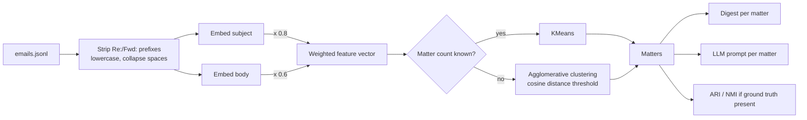

# Email Matter Grouping System

A legal team's inbox mixes threads from many client matters: a litigation
update, a contract redline, a patent query, often with only "Re:" or "Fwd:" to
tell them apart. This project sorts emails into matters automatically, then
produces a per-matter digest (participants and chronology) or a structured
prompt for an LLM to write a fuller summary.

It started as a take-home assignment, a single Colab notebook plus a written
report. It is now a small Python package with a command-line tool, a test
suite, and the notebook kept as a walkthrough.

Everything runs offline. The default pipeline uses TF-IDF and scikit-learn, so
there is no API key, no paid service and no model download.

## Quick start (Docker)

```sh
docker build -t matter-grouping .
docker run --rm matter-grouping generate > emails.jsonl
docker run --rm -i matter-grouping group - < emails.jsonl
docker run --rm -i matter-grouping summarize - < emails.jsonl
```

## Local setup

Python 3.12 is pinned in `.python-version`.

```sh
python3.12 -m venv .venv
. .venv/bin/activate
pip install -r requirements-dev.txt -e .
pytest
```

`requirements.txt` holds the exact runtime versions the tests were run with.
`pyproject.toml` declares the compatible ranges.

## Usage

The tool reads and writes emails as JSON Lines, one email per line:

```json
{"email_id": 16, "sender": "ebrown@example.org", "recipient": "vmartin@example.net", "timestamp": "2024-01-21T04:33:44.244283", "subject": "Fwd: Property Dispute Resolution", "body": "Updates have been made on the property dispute. Please examine the legal analysis and offer your guidance on the next steps.", "true_matter_id": 4}
```

`true_matter_id` is optional. When every email has it, `group` also reports
how well the predicted grouping matches.

### `generate`: synthetic mailbox

```sh
matter-grouping generate --count 25 --replies 3 --seed 7 -o emails.jsonl
```

This writes 25 emails across four legal matters plus 3 threaded replies. The
data is seeded, so the same seed always gives the same mailbox. Addresses come
from Faker's safe mode, so they only use the reserved `example.com/.net/.org`
domains.

### `group`: assign emails to matters

```text
$ matter-grouping group emails.jsonl
28 emails -> 4 matters
  matter 2: Property Dispute Resolution (6) [16, 9, 25, 27, 21, 5]
  matter 3: Litigation Case Update (7) [7, 10, 23, 20, 15, 2, 12]
  matter 0: Patent Infringement Inquiry (8) [3, 17, 1, 22, 26, 18, 14, 11]
  matter 1: Contract Negotiation Discussion (7) [19, 28, 13, 4, 8, 6, 24]
silhouette (cosine): 0.789
ARI: 1.000  NMI: 1.000  (against true_matter_id)
```

Options:

| Option | Effect |
|---|---|
| `--clusters N` | Use KMeans with a known matter count. If omitted, matters are found with a distance threshold. |
| `--threshold 0.5` | Cosine distance that separates matters in threshold mode. |
| `--subject-weight 0.8` | Share of each email vector given to the subject line. |
| `--embedder sbert` | Use Sentence-BERT instead of TF-IDF (needs the `sbert` extra, see below). |
| `--json` | Machine-readable output with per-email assignments. |

```text
$ matter-grouping group emails.jsonl --clusters 4 --json
{
  "clusters": 4,
  "silhouette": 0.7893143710653435,
  "scores": {
    "ari": 1.0,
    "nmi": 1.0
  },
  "assignments": [
    {
      "email_id": 16,
      "matter": 3
    },
    ...
```

### `summarize`: per-matter digest or LLM prompt

```text
$ matter-grouping summarize emails.jsonl
Matter 2: Property Dispute Resolution
  6 emails, 2024-01-21 to 2024-12-04
  Participants (10): brownjacqueline@example.net, christopher67@example.com, ...
  Chronology:
    2024-01-21 04:33  #16  ebrown@example.org -> vmartin@example.net: Fwd: Property Dispute Resolution
    2024-05-07 15:45  #9   brownjacqueline@example.net -> ymitchell@example.net: Property Dispute Resolution
    2024-09-29 07:46  #25  timothywhite@example.net -> christopher67@example.com: Re: Property Dispute Resolution
    2024-09-30 01:46  #27  christopher67@example.com -> timothywhite@example.net: Re: Property Dispute Resolution
    ...
```

`--prompt` prints one prompt per matter instead. Each prompt asks for five
sections: recap of instructions, recipient details, scope of work and fees,
ongoing tasks, and a chronology. It contains every email's metadata and body,
and tells the model to write "Not stated in the correspondence" for any
section the emails don't support. You can paste it into any LLM.

All commands accept `-` for stdin, so they chain:
`matter-grouping generate | matter-grouping summarize -`.

## How it works



| Module | Role |
|---|---|
| `matter_grouping/emails.py` | `Email` record, JSON Lines I/O, subject normalisation |
| `matter_grouping/synthetic.py` | Seeded generator with four matter templates and threaded replies |
| `matter_grouping/grouping.py` | Embedders (TF-IDF, optional Sentence-BERT), feature weighting, clustering |
| `matter_grouping/metrics.py` | ARI/NMI against ground truth, Jaccard baseline for summaries |
| `matter_grouping/summary.py` | Per-matter digests and LLM prompts |
| `matter_grouping/cli.py` | The `matter-grouping` command |
| `Technical_Assignment_Email_Matter_Grouping_System.ipynb` | Walkthrough of the stages using the package |

## Design choices

**Subject and body are embedded separately.** Within one matter, the subject
stays the same while the body wording changes from email to email. Replies
often carry nothing but "Following up on our previous discussion". If subject
and body are concatenated, the body dominates and KMeans splits a matter by
body wording. Here each part is embedded on its own, and the subject gets 0.8
of the vector (the body gets 0.6, so every row stays unit length). The
notebook shows the difference on the seed-7 mailbox:

```text
$ matter-grouping group emails.jsonl --subject-weight 0
28 emails -> 9 matters
...
ARI: 0.487  NMI: 0.724  (against true_matter_id)
```

**Reply prefixes are stripped before embedding.** "Re:" and "Fwd:" (stacked,
any case) say nothing about which matter an email belongs to.

**A distance threshold when the matter count is unknown.** A real inbox
doesn't say how many matters it holds. Choosing k by the best silhouette
score was tried and dropped, because it rewards splitting near-duplicate
emails apart. On the seed-7 mailbox, KMeans silhouette peaks at k=5 (0.837),
not at the true k=4 (0.789). Average-linkage
agglomerative clustering with a cosine distance threshold of 0.5 gives
ARI 1.0 across the generator seeds in the tests.

**TF-IDF by default, Sentence-BERT optional.** The original notebook used
Sentence-BERT (`all-MiniLM-L6-v2`). It is still available:

```sh
pip install -e '.[sbert]'
matter-grouping group emails.jsonl --embedder sbert
```

It installs PyTorch and downloads the model on first use, so it is not the
default. On this synthetic data TF-IDF is already exact, while on real mail
with paraphrased subjects the semantic model would be worth the download.

**No hosted LLM call.** The notebook called Gemini. Instead of depending on a
paid API, `summarize` builds a deterministic digest and can print the prompt.
The original prompt also included fixed fee and task sentences that appear in
no email, so the model summarised terms nobody had written. The prompt now
contains only what the emails say.

## Results

On the seed-7 mailbox (28 emails, 4 matters), both modes recover the matters
exactly (ARI 1.000, NMI 1.000). The tests repeat this for five other seeds
with 46 emails each. This says the pipeline handles reply prefixes and varied
bodies. It says little about real inboxes, where matters share vocabulary and
subjects drift.

`Technical Report_ Email Matter Grouping System.pdf` is the original
write-up of the assignment. It describes the first, notebook-only version
(Sentence-BERT plus Gemini) and has not been updated for this package.

## Tests and lint

```sh
pytest          # 58 tests, all on synthetic data, no network needed
ruff check .
ruff format --check .
```

## License

MIT, see [LICENSE](LICENSE).
